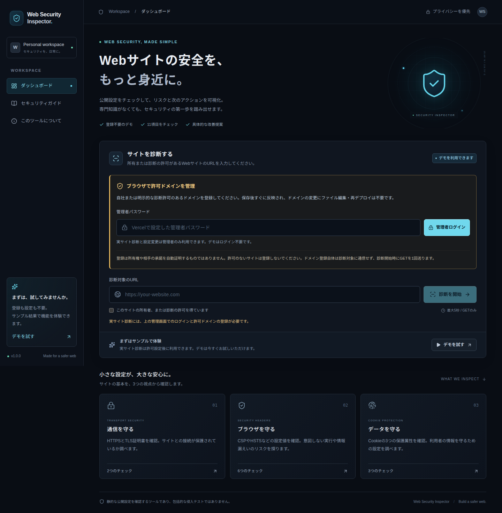
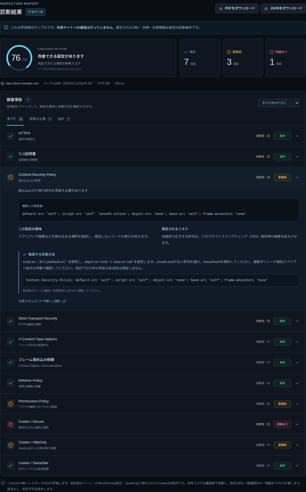
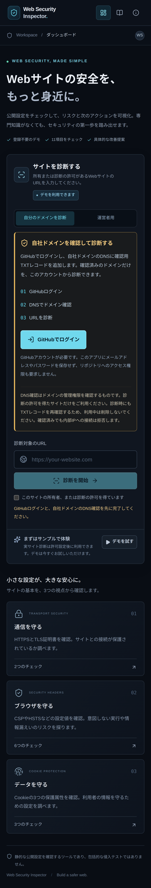
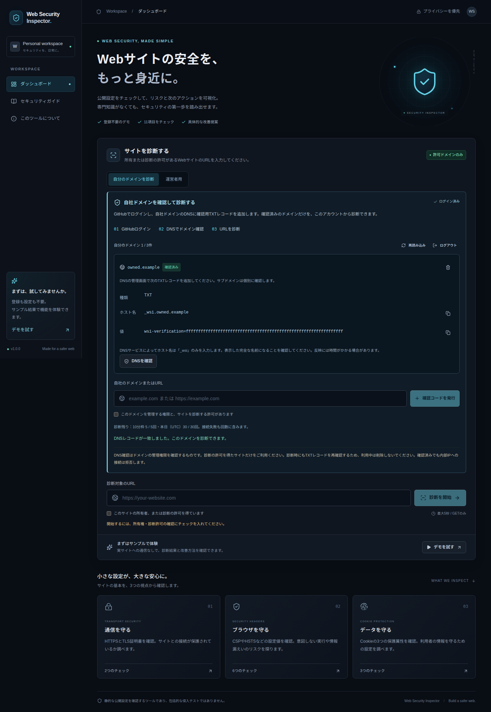
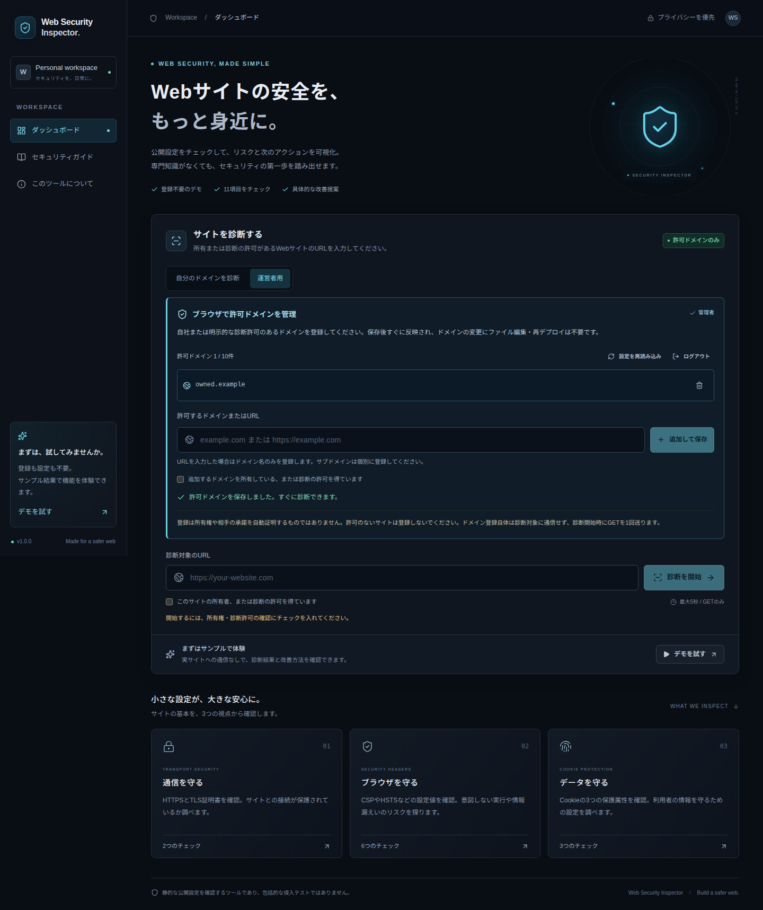

# Web Security Inspector

**Webサイトの安全を、もっと身近に。**

自社WebサイトのHTTPS、TLS証明書、セキュリティヘッダー、Cookieの公開設定を確認し、リスクと改善方法を日本語で表示するWebアプリです。登録不要のデモを用意しているため、環境変数を設定しなくても機能を体験できます。

> 静的な公開設定を確認するツールであり、包括的な侵入テストではありません。参考スコアや「良好」の結果は、サイト全体の安全性を保証しません。

> **訪問者も自社サイトを診断できます。** GitHubログイン → 自社ドメインを登録 → DNSのTXTレコードで管理権限を確認 → URLを診断。各ユーザーは自分の確認済みドメインだけを利用できます。デモは引き続きログイン不要です。運営者による初回のOAuth・Private Blob設定は[Vercelの初期設定](#vercelへのデプロイと初期設定)をご覧ください。



<details>
<summary>デモの診断結果・スマートフォン表示</summary>





</details>

## 主な機能

- 日本語UI、ダークテーマ、PC・スマートフォンに対応
- 外部サイトと通信しない固定データのデモ（登録不要）
- GitHub OAuthログイン、ユーザー別ドメイン管理、DNS TXTによる管理権限確認
- 診断ごとのDNS再確認と、インスタンスをまたぐユーザー別の利用回数制限
- HTTPS・TLS・ヘッダー・Cookieの11項目の診断
- 良好・要確認・問題あり・該当なし・判定不可を区別
- 重要度、設定値、技術的な意味、リスク、推奨対策、公式資料へのリンク
- 結果・カテゴリでの絞り込みと、詳細の展開
- デモ／実サイトの区別を含むJSONダウンロード
- 日本語フォントを埋め込んだA4縦のPDFダウンロード（全検査項目・改善方法・公式資料リンクを収録）
- セキュリティガイドとデータ取り扱いの説明

## 技術スタック

- Next.js 16（App Router / Node.js Route Handler）
- React 19 / TypeScript（strict）
- Tailwind CSS 4
- shadcn/ui方式のローカルコンポーネント（Radix Slot / class-variance-authority）
- lucide-react
- Vercel Labs `guarded-fetch` / undici
- GitHub OAuth（state・PKCE S256）/ Vercel Private Blob
- Vitest / Playwright
- pdf-lib / @pdf-lib/fontkit / M PLUS 1p（日本語PDF出力・SIL Open Font License 1.1）

依存関係の正確なバージョンは`package-lock.json`に固定しています。Node.js 22で動作確認しました。開発・本番ともNext.js公式のWebpack方式を使用し、この実行環境で発生したTurbopackの内部ポート制約を回避しています。データベースやPythonは使いません。

## PDFで診断結果を保存

診断結果の右上にある「PDFをダウンロード」から、全検査項目をA4縦のレポートとして保存できます。画面の絞り込みや詳細の開閉には影響されません。設定値・意味・リスク・改善方法・設定例・公式資料へのリンクと、デモや診断範囲の注意書きを収録します。

ファイル名は`yyyy-mmdd-hhmm_サイト名_診断結果.pdf`です。日時は診断結果の日時を日本時間に変換し、サイト名にはサブドメインを含むホスト名を使います。例：`2026-1020-1430_example.com_診断結果.pdf`。

PDF用ライブラリと同梱の日本語フォントは保存時に読み込みます。生成はブラウザ内で行い、再診断・利用回数の消費・診断結果のサーバー保存は行いません。フォントの配布元・ライセンスは[public/fonts/README.md](public/fonts/README.md)を参照してください。デモを保存した場合、日時は架空のサンプル日時です。

## Ubuntuでのローカル起動

Node.js 22.xとnpmを用意してください。nvmを使う場合は`.nvmrc`を利用できます。

```bash
# このREADMEのあるディレクトリで実行
nvm install
nvm use
npm ci
npm run dev
```

`http://localhost:3000`を開き、「デモを試す」をクリックします。nvm以外でNode.jsを導入済みなら、最初の2行は不要です。未ログイン、または確認済みドメインがない状態では、実サイト診断ボタンが無効になり、APIも通信を拒否します。デモの利用に環境変数は不要です。

本番モードをローカルで確認する場合：

```bash
npm run build
npm start
```

## ブラウザからの実サイト診断設定

### 訪問者：自分のドメインを診断

1. 「自分のドメインを診断」で「GitHubでログイン」を押します。GitHubアカウントが必要です。
2. 自社ドメインまたはURLを入力し、管理権限と診断の許可にチェックを入れて「確認コードを発行」を押します。
3. 自社のDNS管理画面に、表示されたTXTレコードを追加します。例：名前は`_wsi.example.com`、値は`wsi-verification=<ユーザー・ドメインごとのランダム値>`です。DNSサービスによっては名前欄に`_wsi`のみを指定します。
4. 反映後に「DNSを確認」を押します。一致した場合だけ「確認済み」になります。初回の確認コードは7日間有効で、期限切れなら削除して登録し直します。
5. 診断対象URLと診断の許可を確認し、「診断を開始」を押します。診断のたびに同じTXTを再確認するため、利用中はTXTを残します。

ユーザーごとに最大3ドメイン、診断は10分あたり5回・UTCの1日あたり30回までです。ドメイン操作と診断を合計した操作は10分あたり20回までです。失敗した診断の予約も回数に含みます。削除と再登録・再ログインで利用回数はリセットしません。

確認は完全一致のホスト名に限定し、`example.com`の確認だけで`www.example.com`は診断できません。他ユーザーが同じドメインを登録しても異なる確認コードになり、先のユーザーのTXTを流用できません。DNSキャッシュやTTLにより、TXTの変更・削除の反映に時間がかかる場合があります。即時に停止したいときは、アプリからドメインを削除してください。すでに始まった診断は完了する場合があります。



### 運営者：従来の許可リスト

「運営者用」タブでは、従来の管理者パスワードと許可リストも引き続き利用できます。このパスワードを訪問者に配布する必要はありません。

1. Vercelで設定した管理者パスワードでログインします。
2. 所有または明示的な許可のあるドメイン、またはURLを入力します。
3. 所有権・診断許可の確認にチェックを入れ、「追加して保存」を押します。
4. 診断対象URLを入力し、診断の許可確認にチェックを入れて「診断を開始」を押します。
5. 不要なドメインは登録一覧の削除ボタンで削除できます。

URLを貼り付けるとドメイン名のみを登録します。最大10件、完全一致のホスト名だけを許可し、サブドメインは個別に登録します。IPアドレス、内部ホスト、ワイルドカード、認証情報、独自ポートは登録できません。許可ドメインでもDNSが危険なIPを返す場合は診断できません。

登録内容はVercel **Private Blob**の非公開JSONファイルに保存します。データベースは使いません。診断ごとに最新の設定を読み、空の一覧・認証切れ・保存先の障害時は通信を拒否します。ドメインの変更には再デプロイ不要です。削除前にすでに開始していた診断は、その実行を完了する場合があります。

管理者・訪問者のセッションは8時間で失効します。管理者パスワードを変更して再デプロイすると管理者セッションが、SESSION_SECRETを変更すると訪問者セッションが無効になります。署名の用途とAPP_ORIGINも分離し、OAuth確認用Cookieをログイン済みCookieに転用できません。パスワードや保存用トークンはクライアントへ配布せず、ログイン状態は署名付きHttpOnly Cookieで管理します。

ログアウトすると、入力URL・診断結果・許可確認を画面から消去し、実行中の診断取得も中止します。ダウンロード済みのPDF・JSONファイルは消去しません。署名付きセッションはサーバーに保存しないため、コピー・窃取されたCookieはログアウトだけでは失効しません。漏えいが疑われる場合は該当するサーバーの秘密値を変更し、再デプロイしてください。GitHub側で連携解除しても、発行済みのアプリセッションは期限まで有効な場合があります。

保存するユーザーデータは、GitHub数値IDのSHA-256による仮名識別子、ドメイン・確認コード・確認時刻・回数制限です。メール・プロフィール・OAuthアクセストークン・リフレッシュトークン・診断結果は保存しません。仮名識別子も利用者に関係するデータとして扱い、Private Blobへの直接公開や一覧APIは設けません。ドメインは本人が画面から削除できます。仮名識別子と回数制限のファイルは残り、運営者による削除が可能です。自動削除・利用者によるアカウント全体削除は今後の課題です。

**旧版からの変更：** ALLOWED_HOSTS環境変数は読み込みません。既存の許可ドメインは管理画面から登録し直してください。ブラウザのlocalStorageやサーバーの一時メモリに許可リストを置く実装ではありません。ログアウト後も設定は保存先に残り、次回の管理者ログインで読み込めます。



デモ用のdemo.example.comと管理画面の画像のowned.exampleは架空の表示対象です。デモ操作・管理画面のテストでそれらのサイトへ通信することはありません。

### 許可のないサイトを登録・診断するリスク

訪問者のDNS確認は、TXTを設定できる管理権限を確認する仕組みです。サイト運営者の診断許可や法的な所有権まで証明するものではありません。運営者用の許可リストにはDNS確認はなく、チェックボックスも自己申告です。どちらの方式も、診断する範囲と許可を確認して利用してください。

管理画面でドメインを登録するだけでは対象サイトに通信しません。実際に診断を開始すると、サーバーから対象URLへGETを1回送ります。アクセス元IP、User-Agent、時刻などが相手のログに残る可能性があります。運用上のリスクとして、監視による検知、アクセス遮断、規約上の問題や問い合わせにつながることが考えられます。繰り返し実行やGETで処理が走るURLでは、負荷や意図しない動作のリスクもあります。HTTP上のGETは読み取りを想定していますが、実装上の副作用まで保証するものではありません。[RFC 9110 §9.2.1](https://www.rfc-editor.org/rfc/rfc9110.html#section-9.2.1)

公開ページの通常のGETやヘッダー確認だけを、一律に不正アクセス罪と断定することはできません。一方で、他人の認証情報の利用やアクセス制御の回避などは別の問題です。違法性や責任は実際の行為、影響、適用される法律・契約によって異なります。[警察庁の解説](https://www.npa.go.jp/bureau/cyber/pdf/1_kaisetsu.pdf)、[不正アクセス禁止法](https://laws.e-gov.go.jp/law/411AC0000000128)

診断する場合は、対象ドメイン・URL、GETによる公開設定確認という方法、実施日時・回数の範囲を所有者と事前に確認してください。自社サイトでも、業務上の権限やホスティング事業者のルールを確認します。学習や動作確認には、外部通信しないデモを利用できます。

## 検査内容

1. **HTTPS**：入力URLの暗号化スキームを確認。HTTPからの自動転送は調査しません。
2. **TLS証明書**：HTTPS接続時にNode.jsの標準検証でチェーン・ホスト名・有効期間を確認。検証を無効にして接続することはありません。
3. **Content-Security-Policy**：強制ポリシーのスクリプト読み込み制限、広すぎる許可、unsafe-inline / unsafe-eval、object-src、base-uriを簡易評価。Report-Onlyだけでは合格にしません。
4. **Strict-Transport-Security**：HTTPS上でmax-ageが有効か確認。0・不正値・重複は問題あり、180日未満は要確認。HTTPでは適用対象外です。
5. **X-Content-Type-Options**：有効なnosniff値を確認。
6. **フレーム埋め込み制御**：CSPのframe-ancestorsまたは有効なX-Frame-Optionsを確認。default-srcをframe-ancestorsの代わりには扱いません。
7. **Referrer-Policy**：有効な値を解析。複数候補がある場合は最後の認識可能な値を評価します。
8. **Permissions-Policy**：カメラ・マイク・位置情報の許可範囲を確認。未設定や広い許可は要確認です。
9. **Cookie / Secure**：応答で発行された全CookieのSecure属性を確認。
10. **Cookie / HttpOnly**：全CookieのHttpOnly属性を確認。JavaScript利用など用途の確認が必要なため、欠落は要確認です。
11. **Cookie / SameSite**：Lax/Strictの明示を推奨。Noneは用途の確認対象、NoneとSecure欠落の併用は問題ありとします。

Cookieが発行されない応答は「該当なし」です。Cookieの値は結果に保存・表示しません。評価器は取得不能な項目の「判定不可」にも対応しますが、実際の接続や本文取得そのものが失敗した場合は結果を生成せず、エラーを表示します。

### スコア

重要度の重みを高=3・中=2・低=1とし、良好=100%・要確認=50%・問題あり=0%で加重平均します。「該当なし」「判定不可」は分母から除外し、有効な評価項目がなければスコアを表示しません。この計算は本ツール独自の参考指標で、外部認証や業界標準の採点ではありません。

### 検査できないこと

- XSS、SQLインジェクション、認証不備など実際の脆弱性の有無
- ログイン後のページ、サイト内巡回、他URL・他ホストの設定
- HTML内meta要素でのポリシー、JavaScriptで発行されるCookie
- CSPの完全な構文検証やサイト固有の実効性、全Permissions-Policy機能
- 証明書失効、暗号スイート、TLS全バージョンの網羅的な検証
- リダイレクト先の設定、HTTPからHTTPSへの強制転送

3xxの場合は転送応答の設定のみを表示します。4xx/5xxも取得した応答として評価し、通常ページとは異なる可能性を画面に表示します。

## セキュリティ設計

訪問者の診断は、同一オリジン・APP_ORIGIN確認 → 署名付きユーザーセッション → 最大4KBのJSONと診断許可 → 接続数制限 → Private Blobの最新ユーザー設定と回数予約 → 確認済みホスト完全一致 → TXT再確認 → 安全なGET → 設定評価の順です。リクエスト本文のuserId・許可リスト・確認済みフラグは認可に使用しません。運営者用APIは管理者認証と従来の許可リストを使い、訪問者のAPIと分離します。

GitHub OAuthは固定のGitHub公式エンドポイントだけに接続し、ランダムなstateとPKCE S256、10分の署名付き確認Cookie、固定のコールバックURLを使用します。任意のreturnToやHostからリダイレクト先を作りません。プロバイダーのトークン・エラー詳細をブラウザへ返しません。CookieはHttpOnly、本番ではSecure、ユーザーセッションはSameSite=Strict、OAuth確認は外部からのコールバックのためLaxです。OAuth用の外部通信は対象サイトへの診断GETとは別です。[GitHub公式のOAuth仕様](https://docs.github.com/en/apps/oauth-apps/building-oauth-apps/authorizing-oauth-apps)

- `guarded-fetch`のDNS事前検査と接続時の検査・IP固定を利用します。単なるDNS検査後の通常fetchにはしません。
- プライベート、ループバック、リンクローカル、CGNAT、危険なIPv6埋め込みアドレスなどを拒否します。
- 許可ホストでもSSRFチェックを省略しません。安全な標準dispatcherを使用します。
- `followRedirects: false`で、転送先には接続しません。
- リクエストはGETのみ。対象サイトにCookieやAuthorizationは送信しません。
- DNS・接続・本文読み取りを含めて5秒、復号後の本文を最大1MiBに制限します。本文は実行せず、結果にも含めません。
- 接続失敗や証明書検証失敗の詳細、内部IP、スタックトレースを画面に返しません。失敗をデモで代用しません。
- `NODE_TLS_REJECT_UNAUTHORIZED=0`の環境では実サイト診断を拒否します。
- APIは同一オリジンのJSON POSTのみ受け付けます。対象への通信はGETです。Origin確認は認証の代わりではありません。
- 訪問者の回数予約はPrivate Blobの最新読み取りとETag条件付き書き込みで共有し、競合時は最大3回まで再評価します。保存に失敗した場合は診断しません。同時実行は1プロセス2件です。
- 診断結果はブラウザのメモリ上で表示し、アプリのDBやlocalStorageには保存しません。ホスティング基盤・診断先サーバーにアクセスログが残る可能性はあります。
- アプリ自体にもnosniff、埋め込み制限、Referrer-Policy、Permissions-Policy、CSPを設定します。Vercel環境ではHSTSも設定します。

**サーバーレスの制限：** ユーザー別の診断・操作回数はPrivate Blobで共有します。一方、OAuth開始・設定読み込み・同時実行の補助制限と、旧管理者APIの制限はプロセス内です。ユーザーがログイン前に大量アクセスする場合や複数アカウントを使う場合には、ユーザー別制限だけではコストを抑えきれません。公開運用ではVercel Firewall/WAFも設定してください。Private Blobへの最新読み取り・書き込みは操作ごとに発生します。ポートフォリオのデモは認証・保存先未設定でも利用できます。

アプリのCSPはNext.jsのインラインスクリプトとスタイルに対応するためunsafe-inlineを許可しています。nonceを用いた厳格なCSPは今後の改善対象です。

実装時に参照した公式資料：[guarded-fetch](https://github.com/vercel-labs/guarded-fetch)、[MDN CSP](https://developer.mozilla.org/en-US/docs/Web/HTTP/Reference/Headers/Content-Security-Policy)、[MDN Set-Cookie](https://developer.mozilla.org/en-US/docs/Web/HTTP/Reference/Headers/Set-Cookie)、[Next.js Route Handlers](https://nextjs.org/docs/app/getting-started/route-handlers)。

## テスト

```bash
npm test
npm run typecheck
npm run build

# 初回のみChromiumをインストール
npx playwright install chromium
npm run test:e2e
```

Ubuntuでブラウザのシステム依存が不足する場合は、Playwright公式の依存関係導入手順を利用してください。既存のChromeを使う場合は次のように指定できます。

```bash
PLAYWRIGHT_CHROMIUM_EXECUTABLE=/opt/google/chrome/chrome npm run test:e2e
```

単体テストではヘッダーの不正値・弱い値、Cookieの複数発行、許可ドメインの完全一致、危険IP、接続時DNS検査、応答サイズ、タイムアウト、転送非追跡、資格情報非送信、APIの拒否処理を確認します。外部サイトへ実際の診断通信は行わず、許可ドメインの応答はモックで検証します。

単体テストではユーザー分離、確認コードの流用・期限切れ・削除後の拒否、DNS再確認、PKCE/state・Cookieの改ざん・署名の用途分離、OAuthの固定URL・エラー非公開、ETag競合時の回数制限も検証します。

E2Eサーバーのパスワード・SESSION_SECRET・GitHubクライアント情報はすべて架空のテスト専用値です。本番には使用しないでください。GitHubへの移動はブラウザ側のモックで止め、ユーザーセッションの検証・ログアウトは実際のAPIを使います。DNS・Private Blob・診断先の境界はモックです。実際のGitHubアカウントでの認可、TXT登録、Private Blobへの実接続はこのテストに含みません。PCとスマートフォン相当のChromiumで、デモ・訪問者の登録とDNS確認・運営者の設定・詳細・PDF/JSON保存・未認証APIの拒否・横方向のはみ出しを検証し、`docs/screenshots/`にサンプル画面を保存します。

## Vercelへのデプロイと初期設定

**この初期設定はすべてブラウザで行えます。ローカルの.env.local編集やCLIは不要です。GitHub push・外部公開はユーザーの確認後に行ってください。**

1. GitHubリポジトリをVercelの「Add New → Project」からImportします。Root DirectoryはこのREADMEのあるディレクトリ、Node.jsは22.x、Install Commandはnpm ci、Build Commandはnpm run buildです。
2. VercelのStorageで専用のBlobストアを作成し、アクセスを**Private**にしてProductionへ接続します。現行SDKでは、自動追加されるBLOB_STORE_IDとVercelのOIDC認証を利用できます。読み書きトークンを使う場合はBLOB_READ_WRITE_TOKENを設定します。手動でOIDCトークンをコピー・固定しません。[SDKの認証仕様](https://vercel.com/docs/vercel-blob/using-blob-sdk)
3. GitHubのSettings → Developer settings → OAuth Apps → New OAuth Appから、ログイン専用のOAuth Appを新規作成します。Homepage URLにアプリの公開URL、Authorization callback URLに`https://your-project.vercel.app/api/auth/github/callback`を設定します。実際のVercel公開URLに置き換えてください。リポジトリ用の既存OAuth Appは使い回しません。
4. VercelのSettings → Environment Variablesで、Productionだけに以下を設定します。秘密値をチャット・README・GitHubへ貼り付けません。
   - **GITHUB_CLIENT_ID**：OAuth Appに表示されるClient ID。
   - **GITHUB_CLIENT_SECRET**：OAuth Appで生成したClient Secret。
   - **SESSION_SECRET**：パスワードマネージャーなどで生成した32文字以上の十分にランダムな値。管理者パスワードとは別の値。
   - **APP_ORIGIN**：公開URLのオリジン。例：`https://your-project.vercel.app`。パス・クエリは含めません。
5. DeployまたはRedeployします。訪問者のログインにADMIN_PASSWORDは不要です。従来の運営者用許可リストも使う場合だけ、別の32文字以上のランダム値をADMIN_PASSWORDに設定してください。
6. 公開URLで実際のGitHubログインを確認し、自社の検証用ドメインでTXT確認・診断・TXT不一致時の拒否を確認します。GitHub OAuth AppやPrivate Blobが未設定・接続失敗の間は、実サイト診断を有効にしません。

Previewには本番の秘密情報・ストアを共有しません。Previewでも利用する場合は専用ストア・異なるSESSION_SECRET・そのURL専用のOAuth AppとAPP_ORIGINを設定してください。ローカルで確認するときも、別のOAuth Appで`http://localhost:3000/api/auth/github/callback`を登録します。

デモだけを公開する場合は、OAuth・管理者パスワード・Blobは不要です。実サイト診断は無効のまま動作します。未ログインの利用者には登録ドメインを返しません。保存先の接続が失敗した場合も、旧環境変数やデモ結果で代用しません。

運営者の設定はweb-security-inspector/allowed-hosts-v1.json、ユーザー別設定はweb-security-inspector/visitors-v1/<仮名識別子>.jsonに保存します。読み取りはget(..., { access: 'private', useCache: false })でキャッシュを迂回し、最新の設定を使用します。更新はETagとifMatchで競合を検出し、別画面の変更を無条件に上書きしません。データベースは不要です。

Private BlobはVercelの利用枠・料金が適用されます。保存データは小さなJSONですが、認証後の設定読み取り・診断・保存でストレージ操作が発生します。必要な利用枠をVercelダッシュボードで確認してください。参考：[Private Blobの作成](https://vercel.com/docs/vercel-blob/private-storage)、[最新設定を取得する方法](https://vercel.com/changelog/vercel-blob-now-supports-consistent-reads-on-private-storage)。

訪問者向けの診断・ドメイン変更APIは最大30秒、従来の運営者向け診断は15秒です。対象サイトへの診断通信自体は5秒・1MiBを維持します。Edge Runtimeや静的exportには対応しません。

開発者がローカルで認証・実サイト診断も確認したい場合だけ、.env.exampleを参考に専用の設定を追加してください。デモには不要です。

## 主なファイル

```text
src/app/                      ページ、全体スタイル、API
src/app/api/inspect/route.ts  入力・許可・悪用防止
src/components/               ダッシュボード、結果詳細、UI部品
src/lib/inspection/evaluate.ts 設定値の評価（ネットワークから独立）
src/lib/inspection/network.ts  安全な外部GETと応答制限
src/lib/inspection/policy.ts   URLと許可ホストの検証
src/lib/admin/                管理者セッションとPrivate Blobへの設定保存
src/app/api/admin/            ログイン・ログアウト・設定API
src/lib/visitor/              GitHub OAuth、DNS確認、ユーザー別保存と回数制限
src/app/api/auth/             GitHubログインと固定コールバック
src/app/api/account/          自分のセッション・ドメイン操作
src/app/api/visitor/inspect/  確認済みドメインに限定した訪問者向け診断
src/lib/inspection/demo.ts     外部通信のないデモデータ
tests/e2e/                    ブラウザ操作テスト
docs/screenshots/             実画面のスクリーンショット
```

## 今後の改善予定

- nonceによるアプリ自体の厳格なCSP
- CSPの詳細な構文解析と複数ポリシーの実効性評価
- Vercel WAFなどによるインスタンス横断の悪用防止
- Cookieの用途ごとのルールと、より詳しい説明
- 所有者の許可がある検証環境での実接続確認
- ユーザーデータの自動保持期限、アカウント削除、セッションの個別失効
- アクセシビリティと各ブラウザでの検証の拡充

## GitHub公開前の確認

- 初回コミットの前に、作者名を公開してよい名前にし、作者メールにはGitHubのSettings → Emailsに表示されるnoreplyアドレスを設定してください。プロジェクト内で`git config user.email "自分のnoreplyアドレス"`を実行すると、そのリポジトリだけに適用されます。Web画面でメールを非公開にするだけでは、ローカルGitの作者メールは変わりません。[GitHub公式の設定方法](https://docs.github.com/en/account-and-profile/how-tos/email-preferences/setting-your-commit-email-address)
- .env.local、.env.production、.vercel、.awsなどは.gitignoreで除外しています。`git add -f`で除外を解除せず、コミット対象を確認してください。.env.exampleには実際の値を入れません。
- テスト内のパスワード・トークン文字列は架空の検証用です。本番の管理者パスワードとして使用しないでください。
- READMEの画像はサンプルデータです。実際の診断結果・入力URL・ダウンロード済みJSONには組織名や公開したくないパスが含まれる可能性があるため、無確認で追加しないでください。
- リポジトリ名、使用するライセンス、実サイト診断を有効にするかどうかをご確認ください。GitHubへのpushとVercelでの公開は、所有者の確認後に実施します。
